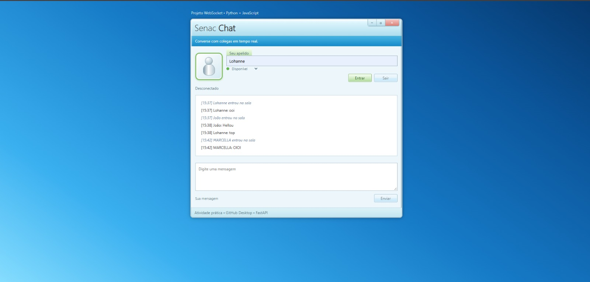

# WebChatApp

Aplicação web desenvolvida em sala de aula com o objetivo da compreenção do conceito de WebSockat.

# Tecnologias

## Interface

- HTML
- CSS
- JavaScript

## Servidor

- Python
  - FastAPI
  - venv

# Tela Principal



# Funcionalidades

- Conexão simultânea de usuários
- Envio de mensagem em tempo real

# Rotas do servidor

## Carrega o template

```python
@app.get("/")
def pagina_inicial():
```

## Manipulação de econexão e envio de mensagens de usuários

```python
@app.websocket("/ws/{nome}")
async def bate_papo(websocket: WebSocket, nome: str):
```

# Como executar??

```powershell
git clone https://github.com/lohannsc/web-socket-chat.git
```

```powershell
python -m venv .venv
```

```powershell
pip install -r requirements.txt
```

```powershell
(.venv) PS C:\...\src python -m uvicorn server:app --port 80000
```
